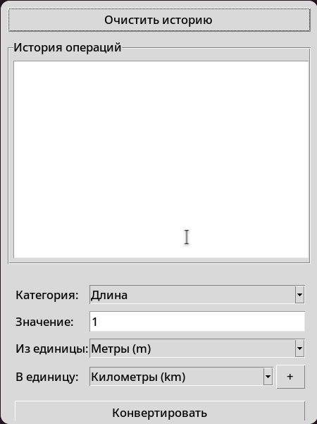
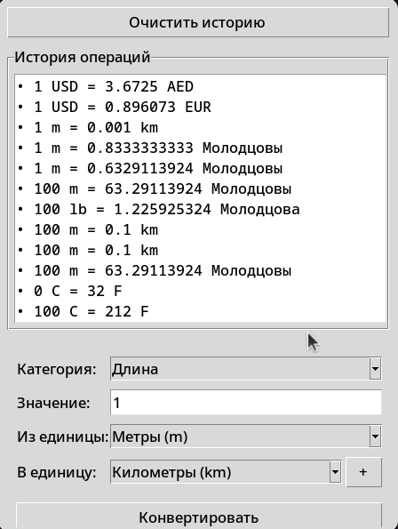
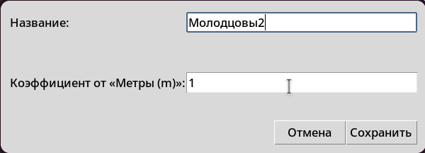

# MCHPY — Конвертер единиц измерения, валют и температуры

## Описание проекта

**MCHPY** - настольное приложение для конвертации единиц измерения,
валют и температуры. Программа разработана на языке Python с
использованием библиотеки Tkinter для создания графического интерфейса.

Приложение позволяет выполнять преобразования различных величин,
работать с пользовательскими единицами измерения, получать актуальные
курсы валют из внешнего API и просматривать историю выполненных
конвертаций.

Проект разработан в рамках учебной работы с использованием Git и GitHub,
системы контроля качества кода, автоматизированного тестирования и CI.

## Возможности приложения

-   Конвертация различных единиц измерения.
-   Конвертация валют с использованием курсов из внешнего API.
-   Перевод температуры между различными шкалами.
-   Добавление пользовательских единиц измерения.
-   Удаление пользовательских единиц измерения.
-   Автоматическое получение и кэширование курсов валют.
-   Сохранение истории конвертаций.
-   Загрузка сохранённых данных при повторном запуске приложения.
-   Обработка некорректного пользовательского ввода.

## Архитектура проекта

Приложение построено на основе объектно-ориентированного подхода.
Основная логика программы сосредоточена в классе `MCHPYApp`.

Основные компоненты:

  |        Компонент          |                            Назначение                             |
  |---------------------------|-------------------------------------------------------------------|
  | `MCHPYApp`                | Основной класс приложения,управление интерфейсом и логикой работы |
  | `convert()`               | Выполнение конвертации                                            |
  | `convert_temperature()`   | Преобразование температуры                                        |
  | `_validate_custom_unit()` | Проверка пользовательской единицы измерения                       |
  | `_save_custom_unit()`     | Сохранение пользовательской единицы                               |
  | `_delete_custom_unit()`   | Удаление пользовательской единицы                                 |
  | `load_all_data()`         | Загрузка необходимых данных                                       |
  | `_refresh_rates()`        | Обновление курсов валют                                           |
  | `_apply_remote_rates()`   | Обработка полученных курсов валют                                 |
  | `add_to_history()`        | Добавление записи в историю                                       |
  | `load_history()`          | Загрузка истории                                                  |
  | `save_history()`          | Сохранение историим                                               |


Для выполнения математических операций используется `Decimal`, что
позволяет избежать некоторых проблем с точностью вычислений при работе с
числами с плавающей точкой.

### Внешний API

Для получения актуальных курсов валют используется сервис
[ExchangeRate-API](https://open.er-api.com/).

Запрос выполняется по адресу:

``` text
https://open.er-api.com/v6/latest/USD
```

Полученные данные обрабатываются приложением и сохраняются в локальном
кэше `rates_cache.json`.

Обновление курсов выполняется в отдельном потоке, чтобы не блокировать
графический интерфейс во время сетевого запроса.

При отсутствии подключения к интернету приложение может использовать
ранее сохранённые данные, если они доступны.

## Структура проекта

``` text
MCHPY/
│
├── .github/
│   ├── PULL_REQUEST_TEMPLATE/
│   │   └── pull_request_template.md
│   │
│   └── workflows/
│       └── ci.yml
│
├── docs/
│   └── README.md
│
├── reports/
│   └── test_report.md
│
├── src/
│   ├── conversion.json
│   ├── mchpy.py
│   ├── money.json
│   ├── rates_cache.json
│   └── temperature.json
│
├── tests/
│   └── test_mchpy.py
│
├── .gitignore
├── .pre-commit-config.yaml
├── LICENSE
└── pyproject.toml

```

### Описание основных директорий и файлов

  |         Компонент         |                   Назначение                   |
  |---------------------------|------------------------------------------------|
  | `.github/`                | Настройки GitHub и автоматизация CI            |
  | `PULL_REQUEST_TEMPLATE/`  | Шаблон Pull Request                            |
  | `orkflows/ci.yml`         | Конфигурация автоматической проверки проекта   |
  | `docs/`                   |  Основная документация проекта                 |
  | `reports/`                | Отчёты о тестировании                          |
  | `src/`                    | Исходный код приложения и JSON-файлы           |
  | `tests/`                  | Модульные тесты                                |
  | `mchpy.py`                | Основной модуль конвертера                     |
  | `test_mchpy.py`           | Набор автоматизированных тестов                |
  | `.gitignore`              | Список файлов, исключённых из Git              |
  | `.pre-commit-config.yaml` | Настройки проверок перед коммитом              |
  | `pyproject.toml`          | Конфигурация проекта и инструментов разработки |
  | `LICENSE`                 | Лицензия проекта                               |

## Используемые технологии

  | Технология  |                   Назначение                  |
  |-------------|-----------------------------------------------|
  | Python 3.12 | Основной язык программирования                |
  | Tkinter     | Создание графического интерфейса              |
  | JSON        | Хранение данных приложения                    |
  | Decimal     | Точные математические вычисления              |
  | urllib      | Выполнение HTTP-запросов                      |
  | threading   | Выполнение фоновых задач                      |
  | pytest      | Запуск автоматизированных                     |
  | pytest-cov  | Анализ покрытия кода тестами                  |
  | Ruff        | Проверка и форматирование кода                |
  | pre-commit  | Автоматические проверки перед коммитом        |
  | Git         | Контроль версий                               |
  | GitHub      | Хранение репозитория и организация разработки |

## Установка и запуск

### Требования

Для запуска приложения необходимы:

-   Python версии 3.12.
-   Git (для клонирования репозитория).
-   Поддержка Tkinter в установленной версии Python.

### 1. Запуск приложения (для пользователей)

Обычным пользователям не требуется устанавливать инструменты разработки и тестирования.

Шаг 1. Получение проекта

Клонируйте репозиторий:

``` bash
git clone https://github.com/rekirieska/MCHPY.git
```

Или скачайте проект в виде  ZIP-архива с GitHub и распакуйте его.

Шаг 2. Переход в папку проекта

``` bash
cd MCHPY
```

Шаг 3. Запуск приложения

Из корневой папки проекта выполните:

``` bash
python src/mchpy.py
```
После запуска откроется графический интерфейс конвертера, в котором можно выполнять необходимые преобразования величин.

### 2. Подготовка среды разработки (для разработчиков и тестировщиков)

Для разработки, проверки качества кода и запуска автоматизированных тестов необходимо дополнительно установить инструменты разработки.

Шаг 1. Установка зависимостей

``` bash
python -m pip install pytest pytest-cov ruff pre-commit
```

Шаг 2. Установка Git Hooks

``` bash
pre-commit install
```

Шаг 3. Проверка качества кода

Проверка кода с помощью Ruff:

``` bash
python -m ruff check .
```

Проверка форматирования:

``` bash
python -m ruff format --check .
```

Шаг 4. Запуск автоматизированных тестов

``` bash
python -m pytest
```

Шаг 5. Проверка покрытия кода тестами

``` bash
python -m pytest --cov=mchpy --cov-report=term-missing
```

После выполнения команд разработчик получит результаты тестирования и информацию о покрытии исходного кода тестами.

## Примеры использования

### Конвертация температуры

Для преобразования температуры используется метод
`convert_temperature()`

Например, перевод 37 градусов Цельсия в градусы Фаренгейта:

``` python
from decimal import Decimal

result = app.convert_temperature(Decimal("37"), "Цельсий (°C)", "Фаренгейт (°F)")

print(result)
```

Ожидаемый результат:

``` text
98.6
```

В данном примере `app` --- экземпляр класса `MCHPYApp`, созданный
приложением.

### Работа с пользовательскими единицами

В приложении предусмотрена возможность добавления собственных единиц
измерения.

Перед сохранением пользовательские данные проходят проверку. Это
позволяет предотвратить сохранение некорректных названий и
коэффициентов.

Пример проверки пользовательской единицы:

``` python
result = app._validate_custom_unit("Новая единица", "2")

print(result)
```

Метод возвращает результат проверки введённых данных.

### История конвертаций

После выполнения преобразований приложение может добавлять информацию о
них в историю.

Для работы с историей предусмотрены методы:

``` python
app.add_to_history(...)
app.load_history()
app.save_history()
```

История сохраняется отдельно от файлов программы и загружается при
последующих запусках.

## Хранение данных

Приложение использует JSON-файлы для хранения исходных данных и кэша
курсов валют.

Файлы `conversion.json`, `temperature.json` и `money.json` располагаются
в папке `src`.

Файл `rates_cache.json` создаётся автоматически при сохранении
полученных курсов валют.

История конвертаций хранится в пользовательском каталоге приложения:

  | Операционная система |                        Путь                            |
  |----------------------|--------------------------------------------------------|
  | Windows              | `C:\Users\User\AppData\Roaming\MCHPY\history_User.txt` |
  | Linux                | `~/.local/share/MCHPY/history_<имя_пользователя>.txt`  |


Если задана переменная окружения `XDG_DATA_HOME`, приложение использует
её для определения каталога пользовательских данных.

Максимальное количество сохраняемых записей истории --- 500.

## Тестирование

Для проверки корректности работы программы используются
автоматизированные тесты на основе `pytest`.

Тесты расположены в папке `tests`.

### Запуск всех тестов

``` bash
python -m pytest
```

### Запуск тестов с анализом покрытия

``` bash
python -m pytest --cov=mchpy --cov-report=term-missing
```

### Создание HTML-отчёта о покрытии

``` bash
python -m pytest --cov=mchpy --cov-report=html
```

После выполнения последней команды HTML-отчёт будет доступен в папке
`htmlcov`.

Тестирование охватывает основные функции приложения, в том числе работу
с JSON-файлами, загрузку данных, пользовательские единицы измерения и
операции, связанные с курсами валют.

## Непрерывная интеграция (CI)

В проекте настроена автоматическая проверка с использованием GitHub
Actions.

Конфигурация находится в файле:

``` text
.github/workflows/ci.yml
```

При отправке изменений в предусмотренные ветки и создании Pull Request
выполняются следующие проверки:

1.  Подготовка окружения Python 3.12.
2.  Установка необходимых инструментов.
3.  Проверка кода с помощью Ruff.
4.  Проверка форматирования кода.
5.  Запуск автоматизированных тестов.

Результаты выполнения проверок отображаются во вкладке **Actions**
репозитория GitHub.

## Контроль качества кода

Для поддержания качества исходного кода используются:

-   **Ruff** - статический анализ и форматирование Python-кода.
-   **pre-commit** - запуск проверок перед созданием коммита.
-   **pytest** - автоматизированное тестирование.
-   **pytest-cov** - анализ покрытия кода тестами.

Проверка кода с помощью Ruff:

``` bash
ruff check .
```

Проверка форматирования:

``` bash
ruff format --check .
```

Автоматическое форматирование:

``` bash
ruff format .
```

Установка Git-хуков:

``` bash
pre-commit install
```

## Организация разработки

Разработка проекта ведётся с использованием Git и GitHub.

В работе применяются:

-   отдельные ветки для реализации задач;
-   Pull Request для объединения изменений;
-   автоматические проверки CI;
-   Code Review;
-   Issues для отслеживания задач и ошибок;
-   Kanban-доска для контроля процесса разработки.

Изменения сначала разрабатываются в отдельных ветках, после чего
проходят проверку и объединяются с основной веткой проекта.

## Скриншоты приложения

Ниже представлены места для добавления скриншотов графического
интерфейса.

### Главное окно



### История конвертаций



### Пользовательские единицы измерения



## Ограничения

-   Для получения актуальных курсов валют требуется подключение к
    интернету.
-   Доступность обновления курсов зависит от работы внешнего API.
-   При отсутствии сетевого подключения используются ранее сохранённые
    курсы, если они имеются.
-   Для корректной работы графического интерфейса необходима поддержка
    Tkinter.

## Версия проекта

**Текущая версия:** `v0.1.0`

Проект находится на этапе учебной разработки.

## Автор

Студенты группы 3-1П11 Молодцова В.С. и Оганян К.Ю.
